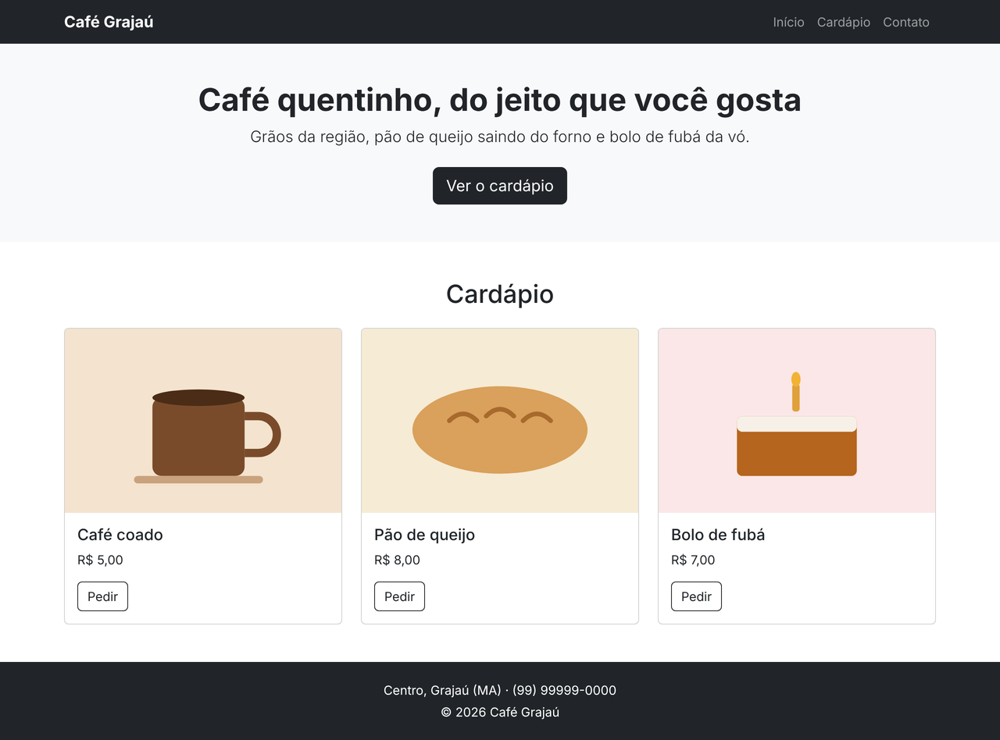

# Café Grajaú com Bootstrap · Desafio prático
O `index.html` já tem todo o texto da página do Café Grajaú, uma cafeteria fictícia, mas sem nenhuma classe. O Bootstrap já está ligado à página.

**Sua missão: deixar a página igual ao print `resultado.png`, usando a documentação do Bootstrap.**

O caminho é sempre o mesmo:

1. Procure o componente na documentação: <https://getbootstrap.com/docs/5.3/>
2. Copie o exemplo.
3. Apague o que não precisa e troque os textos pelos do café.



---

## Como começar

1. Descompacte o projeto e abra a pasta no VS Code.
2. Abra o `index.html` no navegador. Precisa de internet, porque o Bootstrap vem do CDN.
3. Deixe a documentação aberta em outra aba.

```
projeto_inicial_bootstrap/
├── index.html               ← você trabalha aqui
├── style.css                ← não precisa mexer
├── resultado.png            ← como a página deve ficar no computador
├── resultado-celular.png    ← e no celular
└── img/
```

---

## Parte 1 · Menu

**Na documentação:** Components → Navbar

- Barra escura com o nome do café à esquerda e os links à direita.
- No celular, os links ficam escondidos atrás do botão de menu (hambúrguer).
- Apague do exemplo o que o café não usa: dropdown, link desabilitado e campo de busca.

> Dica: para a barra ficar escura, use `bg-dark` e `data-bs-theme="dark"` no `<nav>`. Para os links irem para a direita, use `ms-auto` na `<ul>`.

## Parte 2 · Banner

**Na documentação:** Components → Buttons

- Fundo cinza-claro (`bg-light`), texto centralizado e espaço em cima e embaixo (`py-5`).
- O link "Ver o cardápio" vira um botão escuro e grande.

## Parte 3 · Cardápio

**Na documentação:** Components → Card e Layout → Grid

- Cada produto vira um card, com a imagem no topo e o botão "Pedir" só com contorno.
- Os três cards ficam lado a lado no computador e empilhados no celular.

> Dica: uma `row` com três colunas `col-md-4`, e um card dentro de cada coluna.

## Parte 4 · Rodapé

**Na documentação:** Utilities → Background e Utilities → Colors

- Fundo escuro, texto branco e centralizado, com espaço em cima e embaixo.

---

## Desafios extras

1. Coloque uma etiqueta "Novo" no card do bolo (Components → Badge).
2. Crie uma seção "Perguntas frequentes" com duas perguntas que abrem e fecham (Components → Accordion).
3. Deixe o menu fixo no topo enquanto a página rola (procure "fixed-top" na página da Navbar).

---

